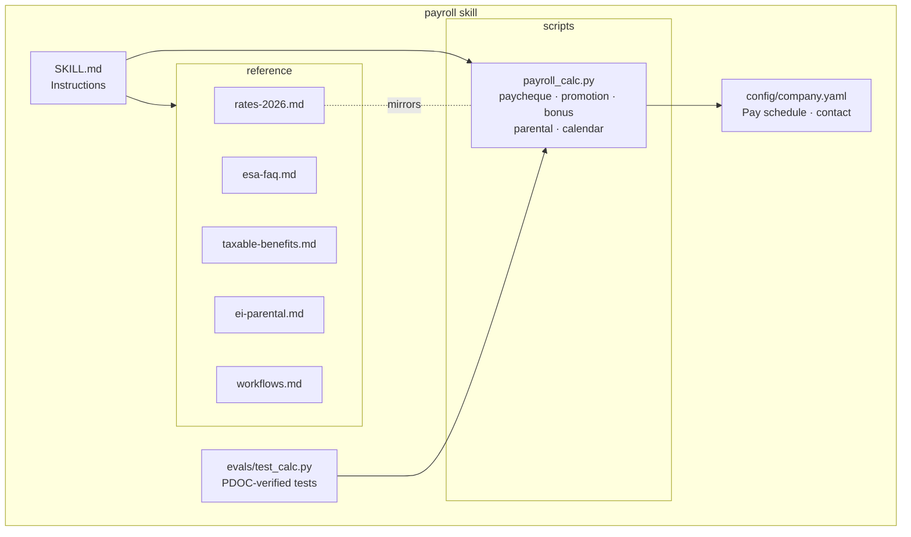
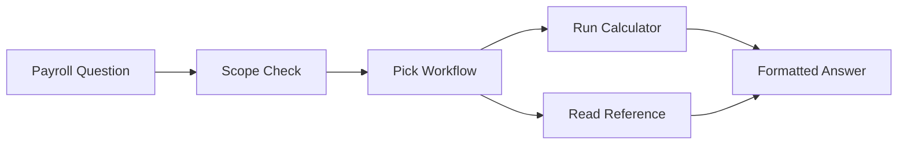

# Ontario Payroll Assistant — Claude Skill

## Introduction

The goal of this project is to give employees and payroll staff instant, reliable
answers to everyday payroll questions without waiting on the payroll team. Instead
of guessing, the assistant answers questions like "what will my cheque be?",
"how does my raise change my pay?", "is this benefit taxable?" and "how much EI
will I get on parental leave?" using CRA's official 2026 payroll formulas.

Every dollar figure comes from a tested calculator rather than the AI's own
arithmetic, so answers are consistent and can be checked. The calculator has been
verified against CRA's Payroll Deductions Online Calculator (PDOC), and company
details such as the pay schedule and payroll contact live in a single settings
file.

**Scope:** Ontario-resident, provincially regulated employees, 2026 tax year.

## Application architecture:

The skill is a folder that Claude loads when a payroll question comes up. It has
three parts: **instructions** (`SKILL.md`), which tell Claude how to handle each
type of request; a **calculator** (`payroll_calc.py`), which does all the math;
and **reference pages**, which hold the rules and rates. Company-specific settings
are kept separately in `company.yaml`, so the same skill can be reused by any
Ontario employer by editing one file.

**Calculation vs policy questions:** Questions that need a dollar amount (cheques,
raises, bonuses, benefits, parental pay, pay dates) always go through the
calculator. Policy questions (vacation, stat holidays, overtime, final pay) are
answered from the reference pages.

**Note:** Anything outside scope (Quebec, other provinces, federal employers,
contractors, company cars, stock options) is routed to the payroll contact instead
of being guessed.

### Skill Structure

Claude reads the instructions, picks the matching workflow, and either runs the
calculator or reads a reference page. The calculator pulls its rates from a single
block that mirrors `rates-2026.md`, and the pay calendar reads the company's
settings.

## Question-to-Answer Flow

When someone asks a payroll question, Claude checks the scope, picks the matching
workflow, and runs the calculator for any dollar amounts. It then replies in a
fixed format: the answer first, then a breakdown table, the reasons, and the
assumptions it made.

Flow stages:
1. **Scope Check:** confirms it's an Ontario, 2026 question; otherwise routes to
   the payroll contact.
2. **Pick Workflow:** matches the request type (new hire, raise, bonus, taxable
   benefit, parental leave, pay date, or policy question).
3. **Run Calculator / Read Reference:** dollar figures come from
   `payroll_calc.py`; rules come from the reference pages.
4. **Formatted Answer:** leads with the answer, then a table (gross, CPP, CPP2,
   EI, federal tax, Ontario tax, net), 1–3 reasons, assumptions, and an
   "estimate only" note.

Example calculator commands:

    python3 scripts/payroll_calc.py paycheque --salary 55000 --freq biweekly
    python3 scripts/payroll_calc.py promotion --old 60000 --new 95000
    python3 scripts/payroll_calc.py paycheque --salary 55000 --noncash-benefits 50
    python3 scripts/payroll_calc.py parental --salary 55000 --type extended
    python3 scripts/payroll_calc.py calendar --from 2026-10-18 --count 6

### Verification

The calculator was checked against CRA's PDOC (Ontario, biweekly, Oct 16, 2026 pay
date), and these cases are saved as automated tests (`python3 -m pytest evals/ -q`,
16 passing):

| Scenario | Skill net pay | CRA PDOC net pay |
|---|---|---|
| $55,000 salary | $1,686.98 | $1,686.98 |
| $150,000, CPP and EI already maxed | $4,084.78 | $4,084.78 |
| $55,000 + $50 non-cash benefit | $1,673.02 | $1,673.03 (rounding) |

## Improvements

1. **Quebec support:** Quebec employees currently get routed away. Adding QPP,
   QPIP, the lower Quebec EI rate and Revenu Québec's tax formulas would cover the
   second-largest province.

2. **Automatic rate updates:** CRA publishes new formulas every January and July,
   and today someone has to update the rates and tests by hand. A scheduled check
   that flags new T4127 editions and re-runs the PDOC comparisons would keep the
   skill current.

3. **Connect to the payroll system:** year-to-date figures currently come from the
   employee's pay stub or are estimated. Connecting to the HR/payroll system
   (e.g. ADP, Workday, Ceridian Dayforce) would give exact year-to-date figures
   and company benefit details.